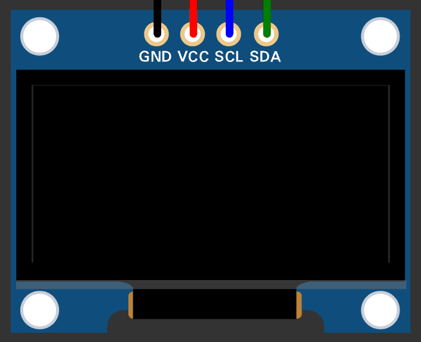

# Bad Apple!! on ESP32 OLED

> "If it has a screen, it can play Bad Apple."

A small Bad Apple!! player built around an ESP32 and a 1.3-inch SH1106 OLED display. It uses pre-processed frames stored in flash memory, rather than trying to decode a video on the microcontroller itself.

## Demo



## How it works

The Python script takes a video, extracts its frames, converts them to the OLED's 128 × 64 monochrome format, and writes the image data to `byteStream.h`.

The ESP32 then reads that data from flash and sends the frames to the display. Since the conversion is done beforehand, the board doesn't need to decode or resize images while the animation is playing.

## Hardware

| Component | Specification |
| --- | --- |
| Microcontroller | ESP32 Development Board |
| Display | 1.3-inch SH1106 OLED |
| Interface | I2C |
| Resolution | 128 × 64 pixels |

### Wiring

| OLED pin | ESP32 GPIO |
| --- | --- |
| GND | GND |
| VCC | 3.3V |
| SCL | GPIO 22 |
| SDA | GPIO 21 |

## Files

- `BadAppleOLED.ino` — the Arduino sketch that plays the animation.
- `byteStream.h` — the generated frame data stored in flash.
- `gen.py` — the Python script used to extract and convert the frames.
- `assets/bad-apple-demo.gif` — the project demo (to be added).

## Getting it running

### 1. Get the code

Clone the repository:

```bash
git clone https://github.com/kshitij-pratap/BadAppleESP32OLED.git
```

Or download it using **Code → Download ZIP** on GitHub and extract the archive.

### 2. Install the Arduino libraries

Install these through the Arduino IDE Library Manager:

- Adafruit GFX Library
- Adafruit SH110X Library

The generated animation data is already included in `byteStream.h`, so Python and OpenCV are not needed just to run the project.

### 3. Choose a partition scheme

The animation data takes approximately 1.8 MB of flash storage. In Arduino IDE, go to:

`Tools → Partition Scheme → Huge APP (3MB No OTA / 1.2MB SPIFFS)`

Make sure the selected app partition has enough room for the compiled sketch and the embedded frame data.

### 4. Connect the display

Wire the OLED to the ESP32 using the pin table above.

### 5. Upload

Open `BadAppleOLED.ino`, select your ESP32 board and COM port, and upload the sketch. The animation should start on the OLED after the board restarts.

## Making your own frame data

You can also use `gen.py` to convert another video into frame data for the display.

This part needs Python and OpenCV. Install OpenCV with:

```bash
pip install opencv-python
```

Then run:

```bash
python gen.py
```

The script generates a new `byteStream.h`. It needs to follow the frame format expected by the Arduino sketch.

---

Built with an ESP32, Python, OpenCV, and a little bit of Touhou magic.
